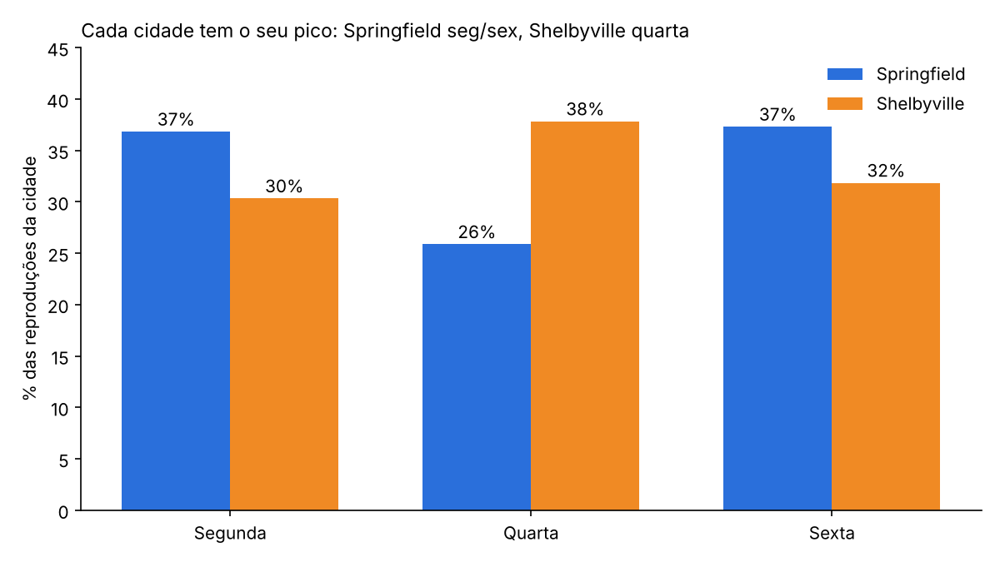

# Se liga na música: o dia da semana muda o jeito que as pessoas ouvem música?

Análise de dados de um serviço de streaming para descobrir se o consumo de música muda conforme a **cidade** e o **dia da semana**.

O tipo de pergunta que importa pra qualquer negócio: **quando e onde concentrar campanha, lançamento ou promoção?**



## Resultado em 30 segundos

- **A hipótese se confirma:** a atividade muda conforme o dia e a cidade.
- **Springfield concentra cerca de 70%** de todas as reproduções.
- **As cidades se comportam de forma oposta:** Springfield tem pico na segunda e na sexta. Em Shelbyville, a quarta é o dia de maior consumo.
- **A média geral enganava:** no total por dia, parecia que todo mundo ouvia menos na quarta. Era Springfield puxando o resultado, porque tem mais volume.

| Dia | Springfield | Shelbyville |
|---|---|---|
| Segunda | 15.740 | 5.614 |
| Quarta | 11.056 | 7.003 |
| Sexta | 15.945 | 5.895 |

## O que isso significa na prática

Uma campanha com o mesmo calendário pras duas cidades estaria errando em uma delas. Em Springfield, o foco seria segunda e sexta. Em Shelbyville, quarta.

A lição vale pra tráfego pago, vendas e atendimento: **segmentar antes de decidir.** Quando um grupo é bem maior que o outro, ele dita a média e esconde o comportamento do menor.

## Como fiz

1. **Visão geral:** 65.079 reproduções, 7 colunas (usuário, música, artista, gênero, cidade, horário e dia).
2. **Limpeza dos dados:**
   - padronizei os nomes das colunas (minúsculo, sem espaços, `snake_case`);
   - preenchi ausentes em música, artista e gênero com `unknown`, sem perder nenhuma reprodução;
   - removi 3.826 linhas duplicadas (quase 6% da base);
   - unifiquei variações do mesmo gênero (`hip`, `hop`, `hip-hop` → `hiphop`).
3. **Análise:** comparei o volume de reproduções por cidade, por dia e cruzando os dois.

## Limitações

- Comparei volumes, sem teste estatístico de significância.
- A base tem só três dias da semana e uma fonte de dados. Não dá pra generalizar para a população inteira das cidades.

## Ferramentas

Python · pandas · Jupyter Notebook

## Arquivos

- `se-liga-na-musica.ipynb` — análise completa, com código e explicações
- `images/` — gráfico usado neste README

## Como rodar

```bash
pip install pandas jupyter
jupyter notebook se-liga-na-musica.ipynb
```

Ajuste o caminho do arquivo `music_project_en.csv` na primeira célula de código, se necessário.

---

**Deivison** — Gestor de tráfego e especialista em marketing digital. Uso dados pra decidir onde investir e onde cortar.
Vamos conversar no [LinkedIn](https://www.linkedin.com/in/deivisonsouza/).
